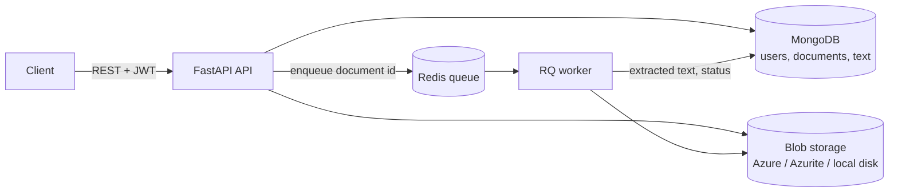
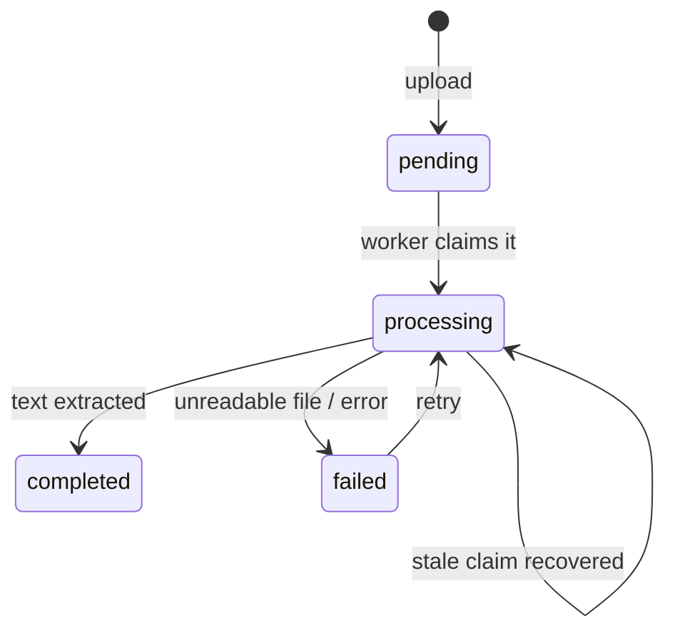

# Clear Read Hub

[](https://github.com/luigi-dv/clear-read-hub/actions/workflows/ci.yml)
[](https://github.com/psf/black)

Clear Read Hub is a platform for readability analysis. Users upload documents (PDF or
plain text), the platform stores them, extracts their text in the background, and
exposes the results through a REST API. The readability engine that scores the
extracted text is the next milestone (see [Roadmap](#roadmap)).

The service is built with FastAPI following Domain-Driven Design (DDD) and a ports and
adapters architecture: the domain and application layers do not depend on FastAPI,
MongoDB, Redis or Azure, which are plugged in at the edges.

## Architecture



Document lifecycle:



| Layer | Path | Contents |
| --- | --- | --- |
| Domain | `src/module/domain` | Entities (`User`, `Document`), value objects (file type, size, name), domain errors, and the ports (abstract repositories and services) |
| Application | `src/module/application` | Use cases: `UserService`, `DocumentService`, `DocumentProcessingService` |
| Infrastructure | `src/module/infrastructure` | Adapters: MongoDB repositories, Azure / local storage, PyMuPDF extraction, bcrypt, JWT, RQ queue, the composition root (`container.py`) and the app factory |
| API | `src/routers` | FastAPI routes and dependencies |

### Reliability and security design

- **Uploads are validated by content.** The type is detected from the file bytes
  (`%PDF-` header, or valid UTF-8 text), not from the name or the `Content-Type`
  header. Size is checked while reading, so oversized uploads are never fully loaded.
- **Files are private.** Blobs are stored under generated keys
  (`{owner_id}/{document_id}.pdf`) and are only downloadable through the API, which
  checks ownership. Other users' documents answer `404`, so ids cannot be probed.
- **Exactly one worker processes a document.** Workers atomically claim a document
  (`find_one_and_update` on its status). A document stuck in `processing` after a
  worker crash is reclaimed once the job timeout has passed.
- **Permanent and transient failures are told apart.** A corrupt or encrypted PDF is
  marked `failed` immediately. Unexpected errors are marked `failed` and re-raised,
  so RQ retries the job with backoff.
- **No orphans.** If the database write fails after a file was stored, the file is
  deleted. Deleting a user deletes their documents and files.
- **Authentication.** Passwords are hashed with bcrypt off the event loop, the login
  takes the same time whether or not the email exists, JWTs are signed with a
  required secret of at least 32 characters and verified against a fixed algorithm.
  API responses never include password hashes.
- **Health checks.** `/health/live` for liveness and `/health/ready` checks MongoDB,
  storage and the queue.

## API

Interactive documentation is served at `/docs` once the API is running.

| Method | Path | Auth | Description |
| --- | --- | --- | --- |
| `GET` | `/` | | Service status |
| `GET` | `/health/live` | | Liveness probe |
| `GET` | `/health/ready` | | Readiness probe (MongoDB, storage, queue) |
| `POST` | `/users` | | Register (`email`, `password`) |
| `POST` | `/oauth2/token` | | Log in (form: `username`=email, `password`), returns a bearer token |
| `GET` | `/users/me` | ✓ | Current user |
| `PATCH` | `/users/me` | ✓ | Change email and/or password (`current_password` required for a new password) |
| `DELETE` | `/users/me` | ✓ | Delete the account and all its documents |
| `POST` | `/documents` | ✓ | Upload a PDF or text file (multipart `file`), returns `202` |
| `GET` | `/documents` | ✓ | List own documents (`limit`, `offset`) |
| `GET` | `/documents/{id}` | ✓ | Document metadata and processing status |
| `GET` | `/documents/{id}/content` | ✓ | Download the original file |
| `GET` | `/documents/{id}/text` | ✓ | Extracted text, one entry per page (`409` until processed) |
| `DELETE` | `/documents/{id}` | ✓ | Delete the document, its file and its text |

Example session:

```bash
curl -X POST localhost:8000/users -H 'Content-Type: application/json' \
     -d '{"email": "reader@example.com", "password": "a-long-password"}'

TOKEN=$(curl -s -X POST localhost:8000/oauth2/token \
     -d 'username=reader@example.com&password=a-long-password' | jq -r .access_token)

curl -X POST localhost:8000/documents -H "Authorization: Bearer $TOKEN" -F file=@paper.pdf
curl localhost:8000/documents/<id>/text -H "Authorization: Bearer $TOKEN"
```

## Getting Started

### With Docker Compose (full stack)

Runs the API, the worker, MongoDB, Redis and Azurite (the local Azure Storage emulator).

```bash
cp .env.example .env
# Edit .env: set JWT_SECRET_KEY and MONGO_ROOT_PASSWORD
docker compose up --build
```

The API is available at <http://localhost:8000/docs>.

### Local development

Requires Python 3.11+ and a MongoDB instance. With the defaults
(`QUEUE_BACKEND=inline`, `STORAGE_BACKEND=local`) no Redis, worker or Azure is needed:
documents are processed inside the API process and stored under `./data/uploads`.

```bash
python -m venv .venv && source .venv/bin/activate
pip install -r requirements-dev.txt
cp .env.example .env               # set JWT_SECRET_KEY and MONGODB_URI
docker compose up -d mongodb       # or any MongoDB
uvicorn main:app --reload
```

To use the background worker locally, set `QUEUE_BACKEND=rq`, start Redis and run
`python worker.py`.

### Configuration

All settings are environment variables (or `.env`), defined and documented in
[`src/service_config.py`](src/service_config.py). The main ones:

| Variable | Default | Description |
| --- | --- | --- |
| `JWT_SECRET_KEY` | **required** | Token signing key, at least 32 characters |
| `MONGODB_URI` | `mongodb://localhost:27017` | MongoDB connection string |
| `STORAGE_BACKEND` | `local` | `local` or `azure` |
| `AZ_STORAGE_CONNECTION_STRING` | | Required when `STORAGE_BACKEND=azure` |
| `QUEUE_BACKEND` | `inline` | `inline` (in process) or `rq` (Redis worker) |
| `REDIS_URL` | `redis://localhost:6379/0` | Redis for the `rq` backend |
| `MAX_UPLOAD_BYTES` | `10485760` | Maximum upload size |
| `MAX_PDF_PAGES` | `500` | PDFs with more pages are rejected |
| `JOB_TIMEOUT_SECONDS` | `300` | Job timeout, also the delay before a stuck document is reclaimed |
| `JOB_MAX_RETRIES` | `3` | Retries for transient processing failures |
| `CORS_ALLOWED_ORIGINS` | | Comma separated list of allowed origins |
| `SENTRY_DSN` | | Enables Sentry error reporting when set |

## Running the tests

```bash
pip install -r requirements-dev.txt

pytest                       # unit, API and property based tests (no services needed)
pytest --cov                 # with coverage
ruff check . && black --check .
```

- `tests/unit`: domain, application services, adapters and API, using in-memory
  implementations of the ports (`tests/fakes.py`) and mongomock for the repositories.
- `tests/fuzz`: property based tests with Hypothesis for the code that handles
  untrusted input (file sniffing, file names, tokens, PDF parsing).
- `tests/integration`: real MongoDB, Redis and Azurite, including the full pipeline
  from upload to the worker. They are skipped unless the services are configured:

```bash
docker compose up -d mongodb redis azurite
MONGODB_URI="mongodb://<user>:<password>@localhost:27017/?authSource=admin" \
REDIS_URL=redis://localhost:6379/0 \
AZ_STORAGE_CONNECTION_STRING="<Azurite connection string from .env.example>" \
pytest -m integration
```

GitHub Actions runs linting, the tests on Python 3.11 to 3.13, the integration tests
against service containers, and builds and smoke tests the Docker image.

## Deployment

The image runs as an unprivileged user and has a health check. The same image runs
both roles:

```bash
docker run ... clear-read-hub api      # uvicorn, WEB_CONCURRENCY workers
docker run ... clear-read-hub worker   # RQ worker
```

For production use `STORAGE_BACKEND=azure` with a real storage account, a managed
MongoDB and Redis, `QUEUE_BACKEND=rq`, and a secret manager for `JWT_SECRET_KEY`.

## Roadmap

- [x] Users and JWT authentication
- [x] Document upload, private storage and background text extraction
- [x] Test suite, CI and containerized stack
- [ ] Readability engine: classic formulas (Flesch, Flesch-Kincaid, SMOG, Dale-Chall)
- [ ] Readability engine: transformer model fine-tuned on human readability ratings
      (the TensorFlow prototype lives in `src/module/infrastructure/machine_learning`,
      its dependencies in `requirements-ml.txt`)
- [ ] `GET /documents/{id}/readability`

## Built With

- [FastAPI](https://fastapi.tiangolo.com/), [Pydantic](https://docs.pydantic.dev/)
- [MongoDB](https://www.mongodb.com/) with the PyMongo async driver
- [RQ](https://python-rq.org/) and [Redis](https://redis.io/)
- [Azure Blob Storage](https://learn.microsoft.com/azure/storage/blobs/) / [Azurite](https://github.com/Azure/Azurite)
- [PyMuPDF](https://pymupdf.readthedocs.io/)

## Authors

- [Luigi Davila](https://github.com/luigi-dv)
